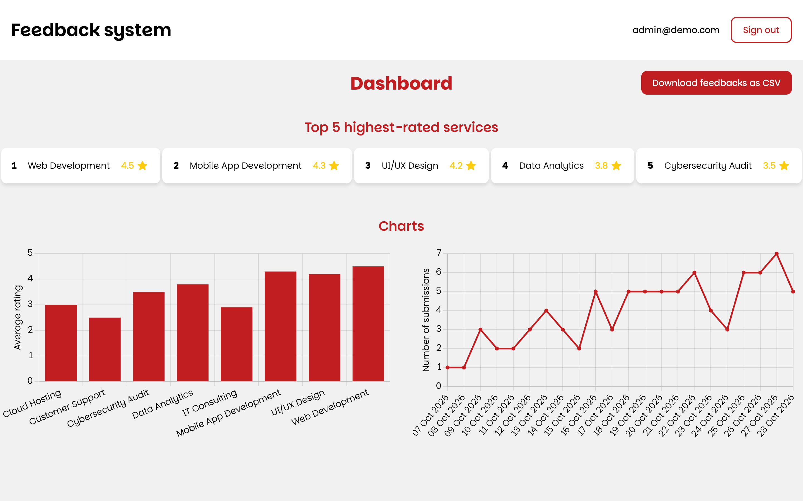
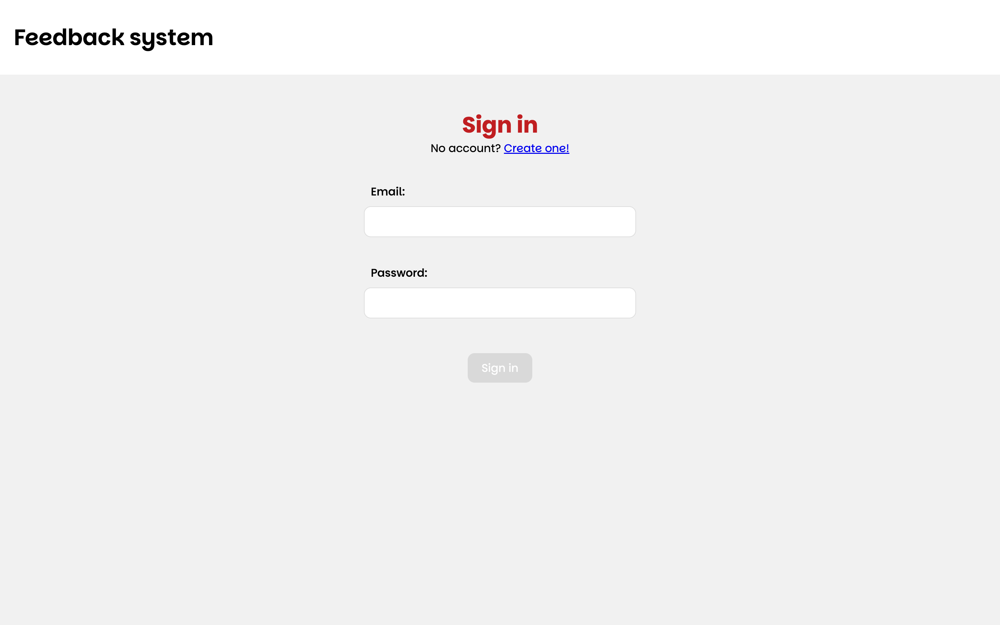
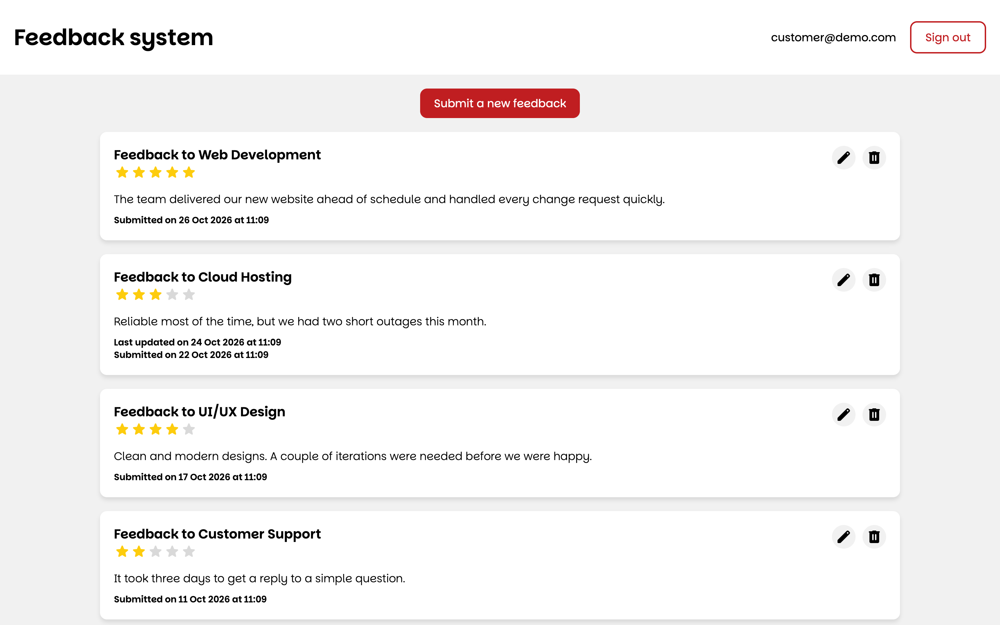
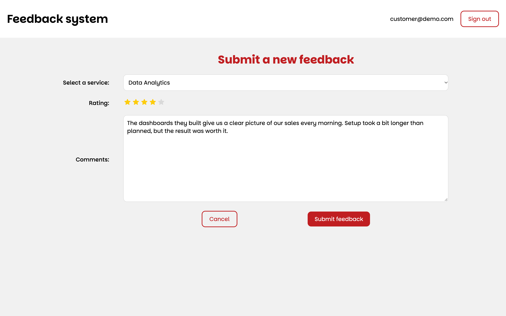
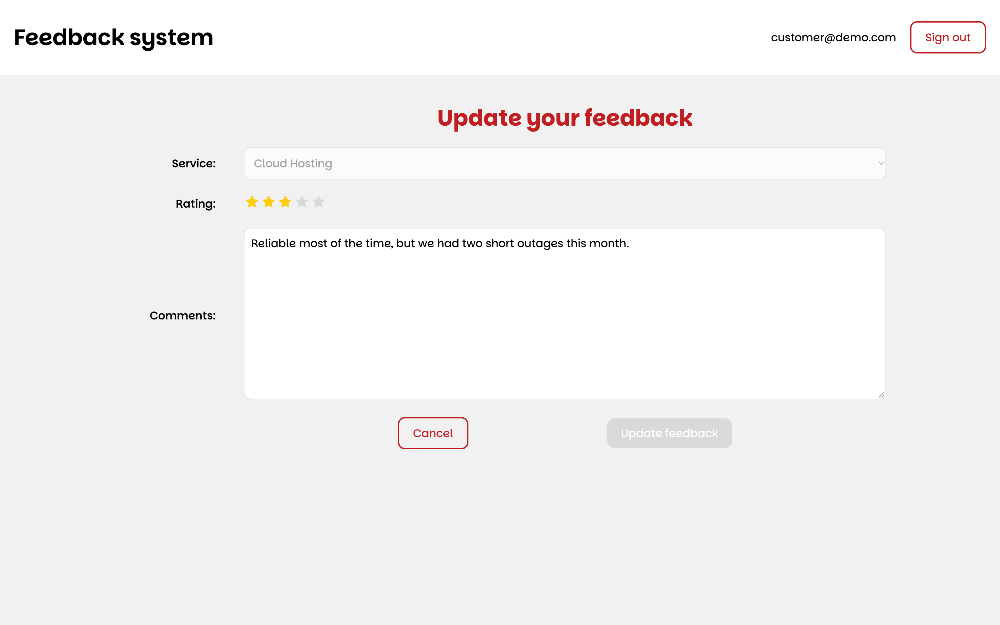
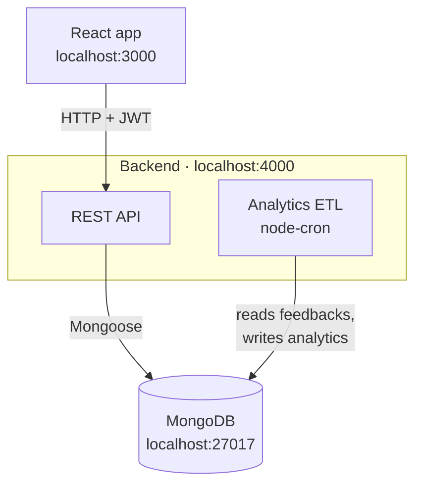
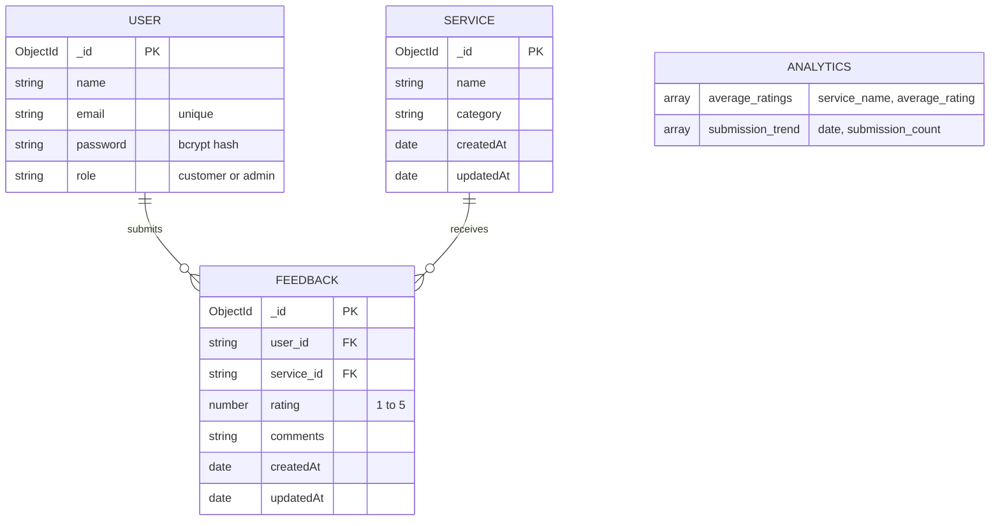

# Feedback system


A full-stack web app where customers rate and review the services a company offers, and admins follow the results on a dashboard with charts and a CSV export. I built it with React, Node.js, Express and MongoDB as the coding challenge for my internship application.



## Contents

- [Features](#features)
- [Screenshots](#screenshots)
- [Tech stack](#tech-stack)
- [How it works](#how-it-works)
- [Getting started](#getting-started)
- [Environment variables](#environment-variables)
- [API reference](#api-reference)
- [Project structure](#project-structure)
- [License](#license)

## Features

Customers can:

- sign up and sign in
- submit feedback for a service, with a rating from 1 to 5 stars and a comment
- see all their feedback, newest first, with the date it was submitted and last updated
- update the rating and comment of a feedback, or delete it

Admins can:

- see the five highest-rated services
- compare the average rating of every service in a bar chart
- follow the number of submissions per day in a line chart
- download every feedback as a CSV file

Behind the scenes, passwords are hashed with bcrypt, every API request is authenticated with a JSON Web Token, and the backend checks the user's role and ownership before it returns or changes any data.

## Screenshots

| Sign in | Your feedback |
| --- | --- |
|  |  |

| Submit a feedback | Update a feedback |
| --- | --- |
|  |  |

## Tech stack

| Layer | Technologies |
| --- | --- |
| Frontend | React 18, React Router 7, Context API with `useReducer`, Axios, Chart.js, Papa Parse |
| Backend | Node.js, Express 4, Mongoose 8, JSON Web Tokens, bcrypt, validator, node-cron |
| Database | MongoDB 7, run locally with Docker Compose |

## How it works

The React app talks to an Express REST API, which stores everything in MongoDB through Mongoose. The dashboard doesn't compute its numbers on every request. Instead, a small ETL job extracts the services and feedback, works out the average rating per service and the number of submissions per day, and loads the result into an `analytics` collection. The job runs when the server starts and then on the schedule set in `UPDATE_TIME` (every night at 02:00 by default), so new feedback shows up on the dashboard after the next run.



### Authentication and roles

Signing up or signing in returns a token that is valid for one hour. The frontend keeps it in local storage and sends it as a `Bearer` token with every request. There are two roles: `customer` and `admin`. Signing up always creates a customer, and the admin account is created by the seed script. Each role only sees its own pages, so customers are sent to their feedback and admins to the dashboard. The API enforces the same rules: customers can only read and change their own feedback, while admins can see all of it and manage services and users.

### Data model



## Getting started

### Prerequisites

- [Node.js](https://nodejs.org/) 18 or newer, with npm
- [Docker](https://www.docker.com/) to run MongoDB, or any other MongoDB instance such as [MongoDB Atlas](https://www.mongodb.com/atlas)

### 1. Clone the repo and start MongoDB

```bash
git clone https://github.com/denisshehu/feedback-system.git
cd feedback-system
docker compose up -d
```

This starts MongoDB 7 on port 27017 and keeps its data in a Docker volume. If you use your own MongoDB instead, skip `docker compose` and set `MONGO_URI` in the next step.

### 2. Start the backend

```bash
cd backend
cp .env.example .env
npm install
npm run seed
npm run dev
```

Set `SECRET` in `.env` to a long random string before you start. The seed script resets the database and fills it with demo data: 8 services, 7 users and three weeks of feedback, so the dashboard has something to show right away. The API then runs on [localhost:4000](http://localhost:4000).

### 3. Start the frontend

In a second terminal, from the root of the repo:

```bash
cd frontend
cp .env.example .env
npm install
npm start
```

The app opens on [localhost:3000](http://localhost:3000).

### Demo accounts

| Role | Email | Password |
| --- | --- | --- |
| Admin | `admin@demo.com` | `Admin123!` |
| Customer | `customer@demo.com` | `Customer123!` |

The seed script also creates five more customers (`ana`, `ben`, `clara`, `david` and `elena`, all `@demo.com`) with the password `Customer123!`. You can also sign up with your own account, which will be a customer. Passwords need at least eight characters, with a lowercase letter, an uppercase letter, a number and a special character.

### Scripts

| Folder | Command | What it does |
| --- | --- | --- |
| `backend` | `npm run dev` | Starts the API with nodemon, restarting on changes |
| `backend` | `npm start` | Starts the API with Node |
| `backend` | `npm run seed` | Resets the database and loads the demo data |
| `frontend` | `npm start` | Starts the React development server |
| `frontend` | `npm run build` | Builds the app for production into `frontend/build` |

## Environment variables

`backend/.env`

| Variable | Description | Example |
| --- | --- | --- |
| `PORT` | Port the API listens on | `4000` |
| `MONGO_URI` | MongoDB connection string | `mongodb://localhost:27017/feedback-system` |
| `SECRET` | Key used to sign the JSON Web Tokens | any long random string |
| `UPDATE_TIME` | Cron expression for when the analytics are recalculated | `0 2 * * *` (every day at 02:00) |

`frontend/.env`

| Variable | Description | Example |
| --- | --- | --- |
| `REACT_APP_BACKEND_URL` | Base URL of the API | `http://localhost:4000` |

## API reference

All routes start with `/api`. Apart from signing up and signing in, every request needs an `Authorization: Bearer <token>` header.

| Method | Route | Access | Description |
| --- | --- | --- | --- |
| `POST` | `/users/signup` | Public | Create a customer account and get a token |
| `POST` | `/users/signin` | Public | Sign in and get a token |
| `GET` | `/users` | Admin | List all users, without passwords |
| `DELETE` | `/users/:id` | Admin | Delete a user |
| `GET` | `/services` | Signed in | List all services |
| `POST` | `/services` | Admin | Create a service |
| `DELETE` | `/services/:id` | Admin | Delete a service |
| `GET` | `/feedbacks` | Signed in | List feedback: their own for customers, all of it for admins |
| `GET` | `/feedbacks/:id` | Owner or admin | Get a single feedback |
| `POST` | `/feedbacks` | Signed in | Submit a feedback |
| `PATCH` | `/feedbacks/:id` | Owner or admin | Update the rating and comments of a feedback |
| `DELETE` | `/feedbacks/:id` | Owner or admin | Delete a feedback |
| `GET` | `/analytics` | Signed in | Get the latest average ratings and submission trend |

For example, to submit a feedback:

```bash
curl -X POST http://localhost:4000/api/feedbacks \
  -H "Authorization: Bearer <token>" \
  -H "Content-Type: application/json" \
  -d '{"service_id": "<service id>", "rating": 5, "comments": "Great service!"}'
```

## Project structure

```
feedback-system/
├── backend/
│   ├── controllers/      # request handlers for users, services, feedbacks and analytics
│   ├── etl/              # extract, transform and load jobs for the dashboard analytics
│   ├── middleware/       # authentication and admin checks
│   ├── models/           # Mongoose schemas
│   ├── routes/           # Express routers
│   ├── scripts/seed.js   # demo data
│   └── server.js         # app entry point
├── frontend/
│   ├── public/
│   └── src/
│       ├── components/   # forms, cards, rating stars, charts and navigation bar
│       ├── contexts/     # global state with Context and useReducer
│       ├── hooks/        # hooks to read each context
│       ├── pages/        # one component per route
│       └── utils/        # API client and Chart.js setup
├── docs/screenshots/
└── docker-compose.yml    # MongoDB
```

## License

This project is licensed under the [MIT License](LICENSE).
